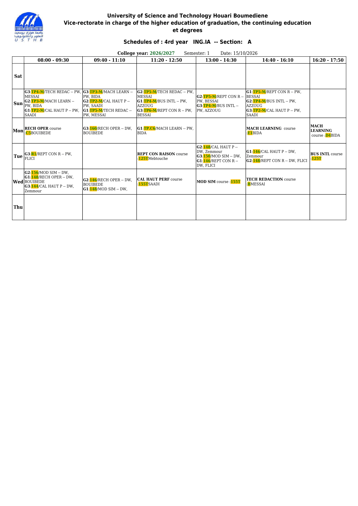
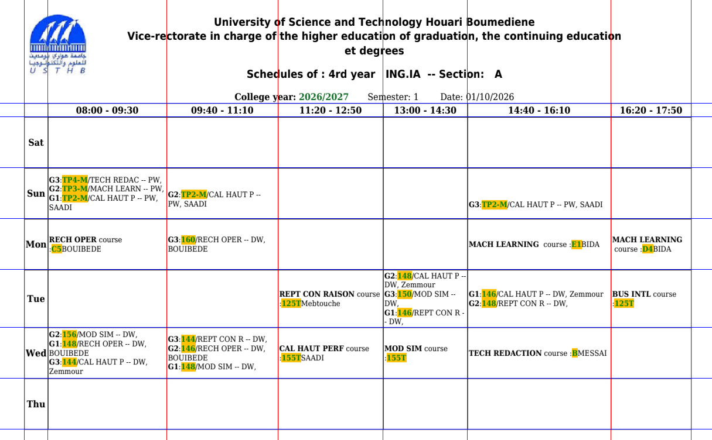
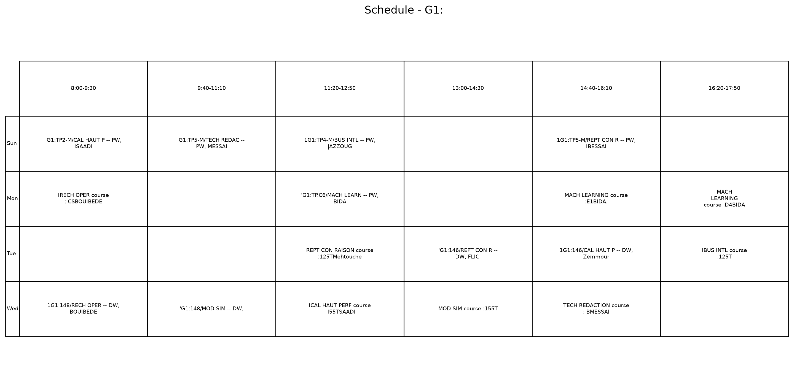
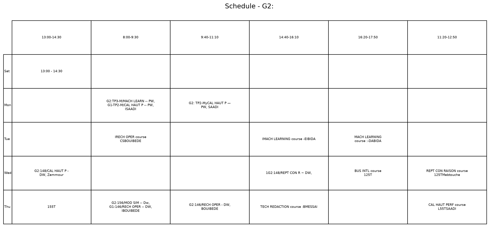
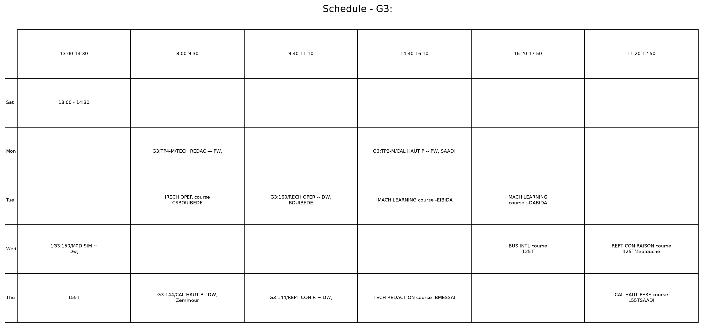

# OCR Schedule

> Turn a shared university timetable image into one schedule image per student group, using local computer vision and OCR rather than an LLM or cloud service.

## Project Overview

University timetables are often published as one large table shared by several groups. A student must manually identify the entries that belong to their own group. **OCR Schedule** automates that task.

The project reads a timetable image, detects the table grid, extracts text from every cell with OCR, associates each entry with a day, time, and group, then generates a separate PNG timetable for each group.

This project demonstrates that a computer can act on a document image locally by combining three distinct stages:

1. **Computer vision** finds the structure of the timetable.
2. **Optical character recognition (OCR)** converts the cropped cells into text.
3. **Rule-based parsing** turns that text into per-group schedule records.

## Input and Output

### Input

- A timetable image in PNG or JPEG format.
- The current project expects the input at `input/image1.png`.
- A PDF must first be converted to an image. For PDFs that contain selectable text, direct PDF text extraction could be a future improvement.

### Output

The pipeline produces intermediate artefacts and final schedules:

| File or folder | Produced by | Purpose |
| --- | --- | --- |
| `preprocessed_image/bin_img.png` | `grid.py` / `cell.py` | Most recently binarized image or cell, useful for visual debugging. |
| `debug_grid.png` | `grid.py` | Original image with detected vertical and horizontal grid lines overlaid. |
| `output/extracted_cells.txt` | `cell.py` | OCR text for all detected cells. |
| `output/data.txt` | `ocr.py` | Structured records containing day, time, group, and text. |
| `output/schedule_G1.png`, etc. | `schedule-result.py` | Final individual timetable image for each detected group. |

## Requirements

- Python 3.10 or later
- Tesseract OCR installed locally and available on the system path
- Python packages:

```bash
pip install opencv-python numpy pytesseract matplotlib
```

### Installing Tesseract

Tesseract is the OCR engine. `pytesseract` is only the Python bridge to that engine.

- macOS: `brew install tesseract`
- Ubuntu/Debian: `sudo apt install tesseract-ocr`
- Windows: install Tesseract, then ensure its installation folder is on `PATH`.

## How to Run

Place the timetable in `input/image1.png`, then run the scripts in this order:

```bash
python grid.py
python cell.py
python ocr.py
python schedule-result.py
```

Each stage reads the artefact produced by the preceding stage. The final schedule images are saved in `output/`.

> **Current implementation note:** run `grid.py` first and inspect `debug_grid.png`. The detected red vertical lines and blue horizontal lines must match the real table borders before OCR can be reliable.

## Pipeline Architecture

```text
input/image1.png
       |
       v
grid.py: binarize image and detect table borders
       |
       v
cell.py: crop every grid cell and run Tesseract OCR
       |
       v
output/extracted_cells.txt
       |
       v
ocr.py: map cells to day, time, and group records
       |
       v
output/data.txt
       |
       v
schedule-result.py: render one PNG timetable per group
```

## Stage 1: Computer Vision and Grid Detection

File: `grid.py`

The input timetable is initially just a matrix of coloured pixels. It does not contain explicit information such as “this is a row” or “this border separates Monday from Tuesday.” The role of computer vision is to recover that structure.

### Binarization

```python
gray = cv2.cvtColor(img, cv2.COLOR_BGR2GRAY)
_, bin_img = cv2.threshold(
    gray, 0, 255, cv2.THRESH_BINARY_INV + cv2.THRESH_OTSU
)
```

First, the image is converted to grayscale, reducing each pixel to brightness only. Otsu's thresholding then automatically selects a brightness threshold that separates the light background from dark writing and table borders. `THRESH_BINARY_INV` makes writing and borders white (`255`) and the background black (`0`).

This matters because OpenCV's later shape operations work most naturally on a clearly separated foreground.

**Visual problem solved:** the program must distinguish table content from its background despite anti-aliasing and small brightness variations in a screenshot.

### Extracting long horizontal and vertical lines

```python
size = w // scale if horizontal else h // scale
shape = (size, 1) if horizontal else (1, size)
kernel = cv2.getStructuringElement(cv2.MORPH_RECT, shape)
opened = cv2.erode(bw, kernel)
return cv2.dilate(opened, kernel)
```

The code creates a long, thin rectangular **kernel**. A horizontal kernel keeps long horizontal strokes; a vertical kernel keeps long vertical strokes.

Erosion removes pixels that cannot contain the complete kernel. Most letters are short and irregular, so they disappear. A table border is long and straight, so it remains. Dilation expands the surviving line again after erosion has shrunk it.

This erosion-then-dilation operation is called **morphological opening**.

**Visual problem solved:** timetable borders and letters are both dark pixels, but the program needs the borders only in order to find cell coordinates.

### Finding each border coordinate

```python
h_fill = horiz.sum(axis=1) / (255 * w)
v_fill = vert.sum(axis=0) / (255 * h)

xs = merge_close(np.where(v_fill > min_fill)[0])
ys = merge_close(np.where(h_fill > min_fill)[0])
```

The program calculates how much white line material exists in every image row and column. A high value means that row or column probably contains a grid border. `min_fill` controls how much of the row or column must be occupied before it counts as a line.

Because a printed border is several pixels thick, `merge_close()` combines nearby detected pixels and replaces them with one average coordinate. This turns a thick border into one clean `x` or `y` position.

`draw_grid()` writes `debug_grid.png`, which should be checked whenever the input format changes.

****
****
****

## Stage 2: Cell Cropping and OCR

File: `cell.py`

After grid detection, adjacent line coordinates define a rectangular cell:

```python
x1, x2, y1, y2 = xs[i], xs[i + 1], ys[j], ys[j + 1]
crop = binarize(input_image[y1:y2, x1:x2])
```

For every row `j` and column `i`, the program crops the pixels bounded by two vertical and two horizontal borders. Each crop is binarized again and passed to Tesseract:

```python
extracted_str[j][i] = pytesseract.image_to_string(crop)
```

The OCR output is stored as a two-dimensional array in `output/extracted_cells.txt`. Its indices preserve the cell's original location in the timetable.

**Visual problem solved:** asking OCR to read an entire timetable at once makes it difficult to determine which text belongs to which day and time. OCR per cell gives each text fragment a known location.

**[Add figure here: one cropped, binarized timetable cell and its OCR result]**

## Stage 3: Creating Schedule Records

File: `ocr.py`

OCR returns plain text, not meaningful schedule objects. The parser converts each cell into records with the form:

```python
{
    "day": "Tue",
    "Time": "14:40-16:10",
    "group": "G1:",
    "text": "CAL HAUT P -- DW, Zemmour"
}
```

The project uses fixed `days` and `times` lists. The row and column positions identify the matching day and time:

```python
records.append({
    "day": days[r],
    "Time": times[c - 1],
    "group": current_group,
    "text": l,
})
```

The regular expression below recognizes group labels such as `G1:`, `G2:`, and `G3:`:

```python
x = re.search("G[1-3]:", l)
```

If no group label has appeared yet, the record belongs to `ALL`, meaning that it is a shared class and should appear in every generated individual schedule.

## Stage 4: Rendering Individual Schedules

File: `schedule-result.py`

The script first gathers all distinct groups. For each group, it combines that group's records with `ALL` records, then builds a lookup table:

```python
grid[(day, time)].append(text)
```

Matplotlib renders the resulting data as a table. The rows are days, the columns are time slots, and each cell contains all entries assigned to that group during that period.

```python
table = ax.table(
    cellText=table_data,
    rowLabels=DAYS,
    colLabels=TIMES,
    loc="center",
    cellLoc="center",
)
```

The final images are written as `output/schedule_<group>.png`.

****
****
****

## Assumptions and Current Limitations

- The input must contain visible, mostly straight table borders.
- The current timetable layout is fixed: six days and six time slots.
- Group labels must follow the `G1:`, `G2:`, or `G3:` pattern.
- OCR accuracy depends on image resolution, clean text, sharp borders, and the quality of the source image.
- PDFs must currently be converted to images before use.
- The scripts are executed manually in sequence; there is not yet one `main.py` command.

### Important Indexing Fix Before Demonstration

`cell.py` extracts the table header row and left day-label column as cells. In `ocr.py`, however, the code currently loops over every extracted row and maps it directly to `days[r]`:

```python
for r, row in enumerate(data):
    ...
    records.append({"day": days[r], ...})
```

For a table containing a header plus six days, this can include the header as Saturday and eventually index beyond the six-item `days` list. The parser should skip the header row and map timetable rows from index `1` onward. This should be fixed before presenting the project as fully runnable.

## Future Improvements

- Add `main.py` to execute the full pipeline with one command.
- Detect day and time headers from the image instead of using fixed lists.
- Support other group formats, such as `A-1` and `A-2`.
- Automatically correct skewed or rotated schedule images.
- Remove grid lines from crops before OCR and tune Tesseract page-segmentation modes.
- Export structured JSON or CSV in addition to final PNG schedules.
- Extract selectable text directly from digital PDFs when available.

## Author and Project Information

- **Author:** `Graia Ramin Mohamed Ryad`
- **Institution:** `USTHB`
- **Academic year:** `2026-2027`
- **Project date:** `October`

